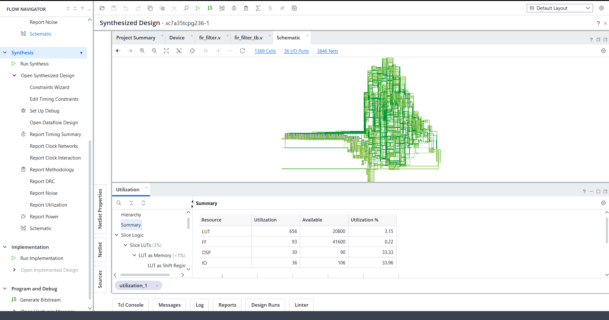
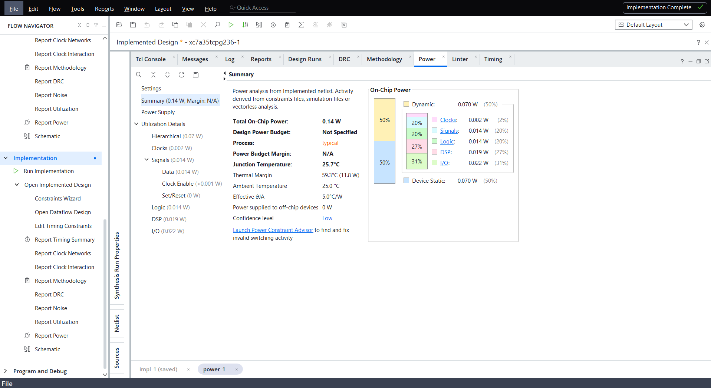

# VLSI Design of FIR Filter for DSP Applications

A 32-tap low-pass Finite Impulse Response (FIR) filter designed using MATLAB and implemented in Verilog HDL, with RTL simulation, FPGA synthesis, implementation, resource utilization, and power estimation using Xilinx Vivado.

## Project Overview

This project demonstrates the digital design flow for an FIR filter, from MATLAB-based filter design and fixed-point coefficient quantization to Verilog RTL implementation and FPGA tool analysis.

The design uses a Hamming window and signed Q1.15 coefficients. The RTL is verified using a testbench, and the design is synthesized and implemented for a Basys 3 Artix-7 FPGA target.

## Design Specifications

| Parameter | Specification |
|---|---|
| Filter type | Low-pass FIR |
| Filter order | 31 |
| Number of taps | 32 |
| Sampling frequency | 48 kHz |
| Nominal cutoff frequency | 6.5 kHz |
| Window function | Hamming |
| Coefficient format | Signed Q1.15 |
| RTL language | Verilog HDL |
| Design tool | Xilinx Vivado 2026.1 |
| MATLAB design tool | MATLAB |
| Target FPGA | Basys 3, Artix-7 |
| FPGA part | xc7a35tcpg236-1 |

## Design Flow

1. Design the low-pass FIR filter in MATLAB.
2. Generate and quantize the filter coefficients into signed Q1.15 fixed-point format.
3. Implement the 32-tap FIR filter using Verilog HDL.
4. Verify the RTL using a testbench.
5. Synthesize the RTL using Xilinx Vivado.
6. Run FPGA implementation and review resource utilization and estimated power.

## Repository Structure

```text
VLSI-FIR-Filter-DSP/
├── MATLAB/
│   ├── fir_design.m
│   ├── fir_reference.m
│   └── [coefficient and design files]
├── RTL/
│   └── fir_filter.v
├── Testbench/
│   └── [testbench source files]
├── Simulation/
│   └── [simulation waveform and verification evidence]
├── Synthesis/
│   └── [synthesis reports and screenshots]
├── Results/
│   └── [filter response plots and analysis]
├── Documentation/
│   └── [project documentation]
├── LICENSE
├── .gitignore
└── README.md
```

The entries in square brackets describe the expected contents. Keep them only as descriptions, or replace them with actual filenames if you want to list specific files.

## MATLAB Filter Design

The filter was designed in MATLAB using a Hamming window. The resulting coefficients were quantized to signed Q1.15 fixed-point representation for use in the Verilog implementation.

### Frequency Response


*Replace this image path with the exact filename of your saved MATLAB frequency-response plot.*

The MATLAB response measurements were approximately:

- At 5 kHz: -0.77 dB
- At 8 kHz: -21.45 dB

These values are the measured response of the designed filter at the specified frequencies.

## RTL Implementation

The Verilog RTL implements a 32-tap fixed-point FIR filter with:

- A delay line for storing input samples.
- Signed fixed-point multiplication and accumulation.
- A 40-bit accumulator.
- An arithmetic right shift by 15 bits to scale the Q1.15 result.
- Output saturation logic.
- `valid_in` and `valid_out` control signals.

The implementation is intended to demonstrate the mapping of a MATLAB-designed DSP algorithm into synthesizable RTL.

## Simulation and Verification

The RTL was simulated using a testbench in the Vivado flow.

**Verification result:**
- Input samples checked: 32
- Mismatches: 0
- Testbench result: PASS


*Add your actual simulation waveform or testbench console screenshot here.*

## FPGA Synthesis Results

The following resource utilization values were obtained from the Vivado synthesis report for the target Artix-7 FPGA.

| Resource | Used | Available | Utilization |
|---|---:|---:|---:|
| LUTs | 656 | 20,800 | 3.15% |
| Flip-flops | 93 | 41,600 | 0.22% |
| DSP blocks | 30 | 90 | 33.33% |
| I/O | 36 | 106 | 33.96% |



*Add your actual Vivado utilization report screenshot here.*

These figures represent synthesis resource utilization and are specific to the reported design and target FPGA.

## FPGA Implementation

The Vivado implementation flow completed routing with zero reported failed routes.


*Add this image only if you have saved the actual implementation-completion screenshot. Create the `Implementation/` folder if needed.*

**Timing limitation:** Timing closure has not been verified because user timing constraints were not specified. A completed implementation flow alone does not establish that the design meets its intended clock timing.

Physical FPGA programming and hardware validation have not been claimed as completed.

## Power Analysis

Vivado reported an estimated total on-chip power of approximately **0.14 W**, consisting of:

- Dynamic power: approximately 0.070 W
- Static power: approximately 0.070 W



*Add your actual power report screenshot here.*

The power report indicated **LOW confidence** and no design power budget was specified. These values are tool estimates, not measurements from physical hardware.

## Fixed-Point Coefficients

The signed Q1.15 coefficient integers used in the filter are:

```text
[31, -15, -80, -127, -71, 139, 407, 470,
 77, -720, -1409, -1209, 432, 3341, 6520,
 8597, 8597, 6520, 3341, 432, -1209, -1409,
 -720, 77, 470, 407, 139, -71, -127, -80,
 -15, 31]
```

The coefficients are symmetric, as expected for a linear-phase FIR filter. Their integer sum is 32766, corresponding to a reconstructed coefficient sum of approximately 0.999939.

## Tools and Technologies

- MATLAB — filter design and coefficient analysis
- Verilog HDL — RTL implementation
- Xilinx Vivado 2026.1 — synthesis and FPGA implementation
- Basys 3 / Artix-7 — target FPGA platform
- RTL testbench — functional verification

## Future Improvements

- Add and validate clock and I/O timing constraints.
- Review timing reports and verify timing closure.
- Validate the design on physical FPGA hardware.
- Compare RTL output against the MATLAB reference across additional input patterns.
- Explore resource optimization and alternative FIR architectures.

## License

This project is released under the MIT License. See the [LICENSE](LICENSE) file for details.

## Author

**Ruturaj Vyavahare**

B.E. Electronics & Telecommunication Engineering  
Interested in VLSI Design, RTL Design, and Design Verification.

- GitHub: [RuturajVyavahare](https://github.com/RuturajVyavahare)
- LinkedIn: [Ruturaj Vyavahare](https://www.linkedin.com/in/ruturaj-vyavahare)

---

If you find this project useful for learning about FIR filters, Verilog RTL, or FPGA design, feel free to explore the repository.
