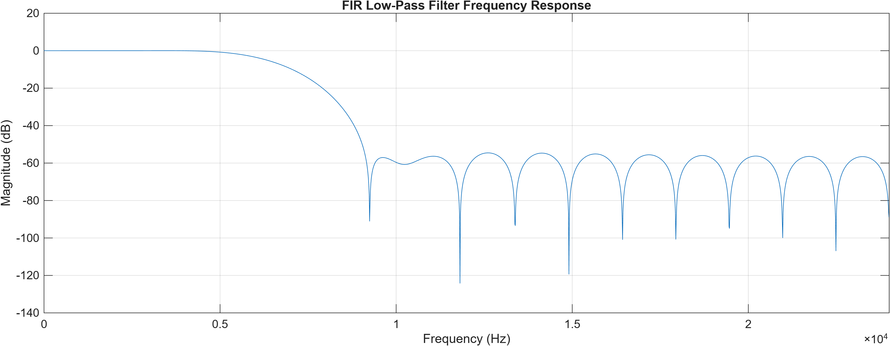
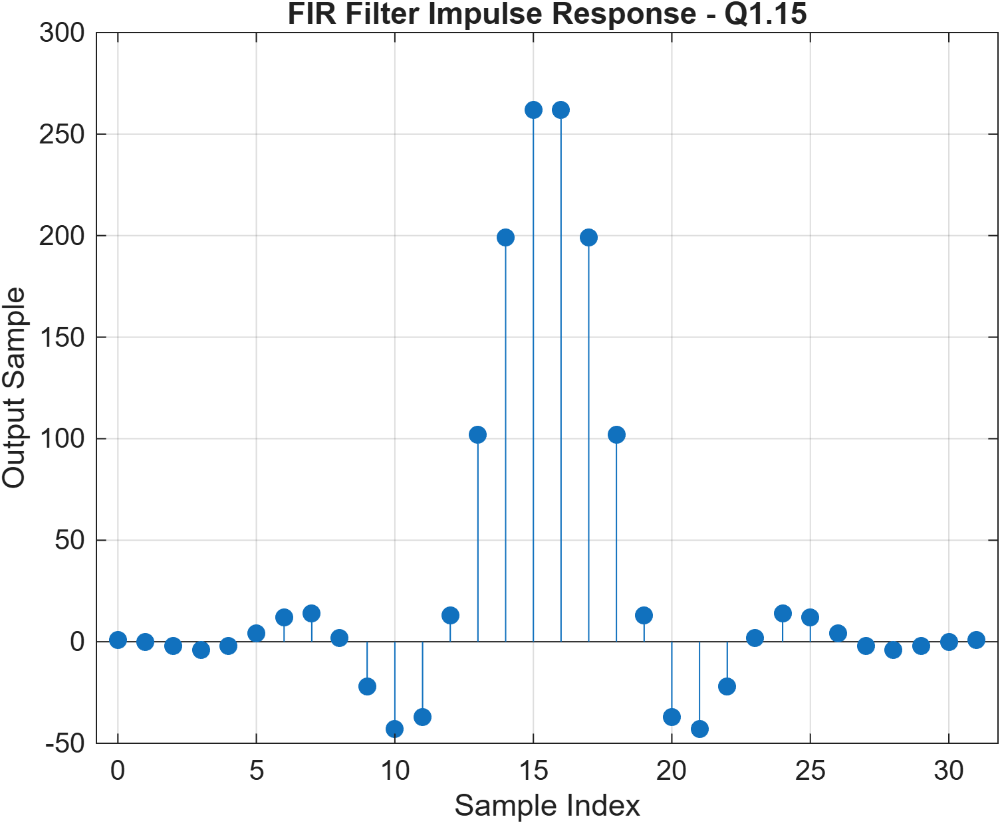
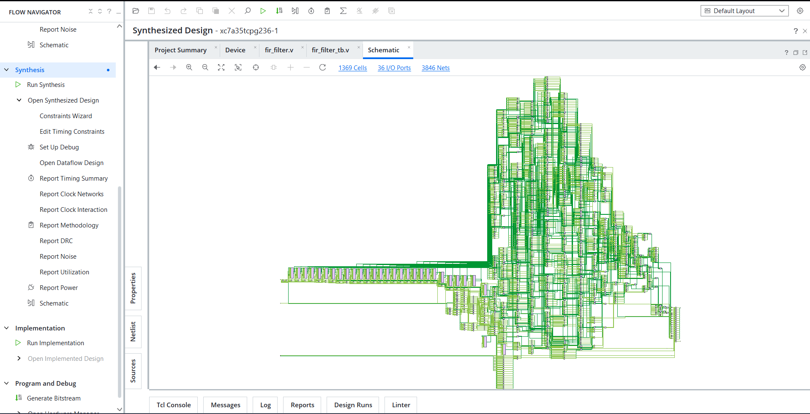
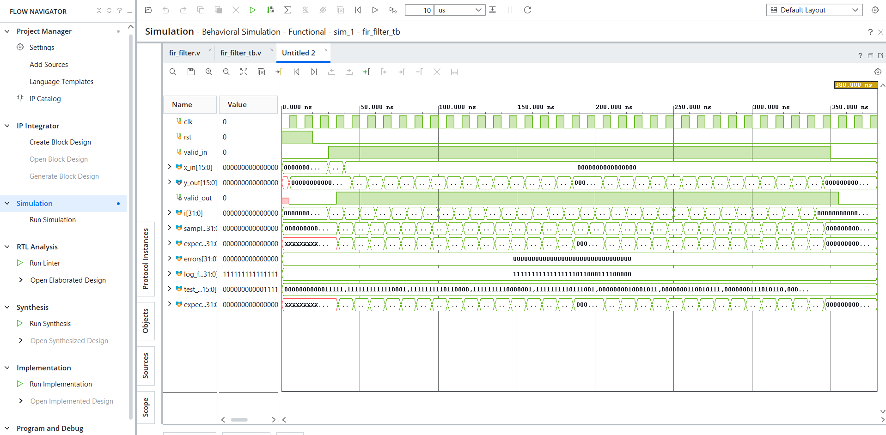
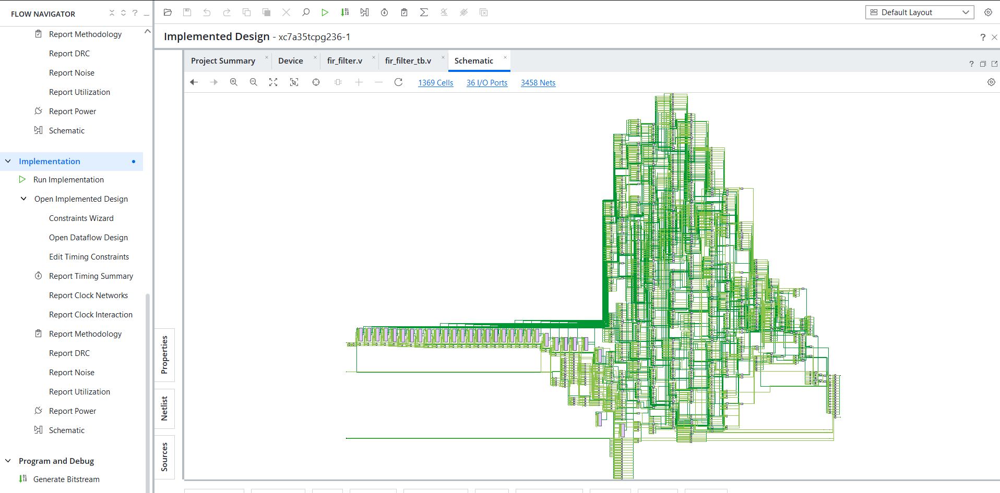
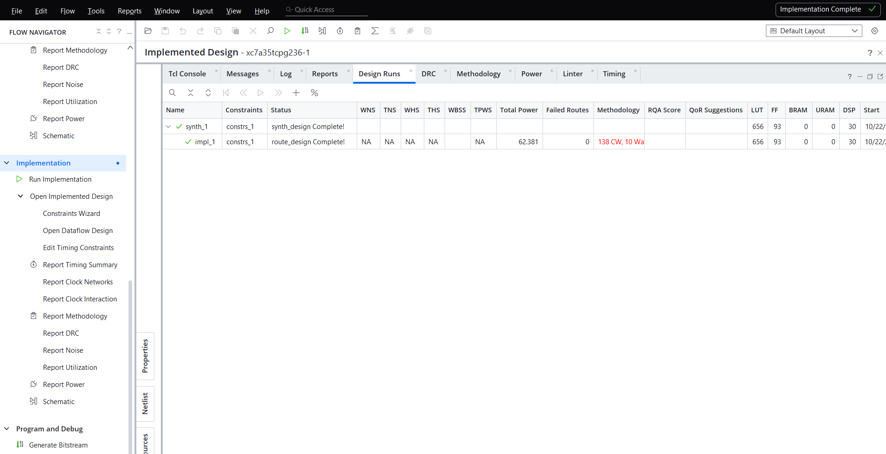

# VLSI Design of FIR Filter for DSP Applications

A 32-tap low-pass Finite Impulse Response (FIR) filter designed using MATLAB and implemented in Verilog HDL. This project demonstrates fixed-point coefficient quantization, RTL simulation, FPGA synthesis, implementation, resource utilization, and power estimation using Xilinx Vivado.

## Project Overview

This project follows the digital design flow for an FIR filter, from MATLAB-based filter design and coefficient generation to Verilog RTL implementation and FPGA tool analysis.

The filter uses a Hamming window and signed Q1.15 coefficients. The RTL is verified using a testbench and synthesized for the Basys 3 Artix-7 FPGA target.

## Design Specifications

| Parameter | Specification |
|---|---|
| Filter type | Low-pass FIR |
| Filter order | 31 |
| Number of taps | 32 |
| Sampling frequency | 48 kHz |
| Nominal cutoff frequency | 6.5 kHz |
| Window function | Hamming |
| Coefficient format | Signed Q1.15 |
| RTL language | Verilog HDL |
| Design tool | Xilinx Vivado 2026.1 |
| Filter design | MATLAB |
| Target FPGA | Basys 3, Artix-7 |
| FPGA part | xc7a35tcpg236-1 |

## Design Flow

1. Design the low-pass FIR filter in MATLAB.
2. Generate and quantize coefficients into signed Q1.15 fixed-point format.
3. Implement the 32-tap filter using Verilog HDL.
4. Verify the RTL using a testbench.
5. Synthesize the design in Xilinx Vivado.
6. Run FPGA implementation and analyze resource utilization and estimated power.

## Repository Structure

```text
VLSI-FIR-Filter-DSP/
├── Documentation/
│   └── MATLAB_Design_Report.txt
├── MATLAB/
│   ├── fir_design.m
│   ├── fir_coefficients.txt
│   ├── fir_coefficients_q15.txt
│   ├── fir_reference_workspace.mat
│   └── FIR_Frequency_Response.png
├── RTL/
│   └── fir_filter.v
├── Testbench/
│   ├── fir_filter_tb.v
│   └── FIR_Reference_Response.fig
├── Simulation/
│   └── FIR_Impulse_Response_Waveform.png
├── Synthesis/
│   ├── FIR_Synthesized_Schematic.png
│   ├── FIR_Implemented_Schematic.png
│   ├── FIR_Synthesis_Utilization.png
│   ├── FIR_Power_Analysis.png
│   └── FIR_Implementation_Complete.png
├── Results/
│   ├── coefficient_validation.txt
│   ├── fir_coefficient_table.csv
│   ├── fir_reference_float.txt
│   ├── fir_reference_output.txt
│   └── FIR_Reference_Response.png
├── LICENSE
├── .gitignore
└── README.md
```

## MATLAB Filter Design

The FIR filter was designed in MATLAB using a Hamming window. Its coefficients were quantized to signed Q1.15 fixed-point format for use in the RTL implementation.

### Frequency Response



### Reference Response



The measured MATLAB response was approximately:

- At 5 kHz: -0.77 dB
- At 8 kHz: -21.45 dB

These are response measurements at the specified frequencies.

## RTL Implementation

The Verilog RTL implements a 32-tap fixed-point FIR filter with:

- A delay line for storing input samples.
- Signed coefficient multiplication and accumulation.
- A 40-bit accumulator.
- Arithmetic right shift by 15 bits for fixed-point scaling.
- Output saturation logic.
- `valid_in` and `valid_out` control signals.

### Synthesized Schematic



## Simulation and Verification

The RTL was simulated using a testbench in the Vivado flow.

**Reported verification result:**

- Input samples checked: 32
- Mismatches: 0
- Testbench result: PASS

### Simulation Waveform



The screenshot above is the saved impulse-response waveform. The zero-mismatch result refers to the testbench run.

## FPGA Synthesis Results

The following resource utilization values were obtained from the Vivado synthesis report for the target Artix-7 FPGA.

| Resource | Used | Available | Utilization |
|---|---:|---:|---:|
| LUTs | 656 | 20,800 | 3.15% |
| Flip-flops | 93 | 41,600 | 0.22% |
| DSP blocks | 30 | 90 | 33.33% |
| I/O | 36 | 106 | 33.96% |

### Resource Utilization


## FPGA Implementation

The Vivado implementation flow completed routing with zero reported failed routes.

### Implemented Schematic



### Implementation Completion



**Timing limitation:** Timing closure has not been verified because user timing constraints were not specified. Completion of the implementation flow alone does not establish that the design meets its intended clock timing.

Physical FPGA programming and hardware validation have not been claimed as completed.

## Power Analysis

Vivado reported estimated total on-chip power of approximately **0.14 W**, consisting of:

- Dynamic power: approximately 0.070 W
- Static power: approximately 0.070 W


The power report indicated **LOW confidence**, and no design power budget was specified. These values are tool estimates, not measurements from physical hardware.

## Fixed-Point Coefficients

The signed Q1.15 coefficient integers used in the filter are:

```text
[31, -15, -80, -127, -71, 139, 407, 470,
 77, -720, -1409, -1209, 432, 3341, 6520,
 8597, 8597, 6520, 3341, 432, -1209, -1409,
 -720, 77, 470, 407, 139, -71, -127, -80,
 -15, 31]
```

The coefficients are symmetric. Their integer sum is 32766, corresponding to a reconstructed coefficient sum of approximately 0.999939.

## Tools and Technologies

- MATLAB — filter design and coefficient analysis
- Verilog HDL — RTL implementation
- Xilinx Vivado 2026.1 — synthesis and FPGA implementation
- Basys 3 / Artix-7 — target FPGA platform
- RTL testbench — functional verification

## Future Improvements

- Add and validate clock and I/O timing constraints.
- Review timing reports and verify timing closure.
- Validate the design on physical FPGA hardware.
- Compare RTL output against the MATLAB reference for additional input patterns.
- Explore resource optimization and alternative FIR architectures.

## License

This project is released under the MIT License. See the [LICENSE](LICENSE) file for details.

## Author

**Ruturaj Vyavahare**

B.E. Electronics & Telecommunication Engineering

Interested in VLSI Design, RTL Design, and Design Verification.

- GitHub: [RuturajVyavahare](https://github.com/RuturajVyavahare)
- LinkedIn: [Ruturaj Vyavahare](https://www.linkedin.com/in/ruturaj-vyavahare)

---

If you find this project useful for learning about FIR filters, Verilog RTL, or FPGA design, feel free to explore the repository.
